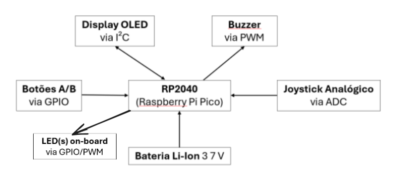

# Jogo Simon Says - Raspberry Pi Pico

Um clássico jogo da memória "Simon Says" implementado para o
microcontrolador Raspberry Pi Pico, utilizando matriz de LEDs, display
OLED, joystick, botões e efeitos sonoros.

## 🎮 Descrição do Jogo

Simon Says é um jogo de memória no qual os jogadores devem repetir uma
sequência de comandos que fica progressivamente mais longa e
desafiadora. O jogo exibe os comandos em um display OLED e fornece
feedback visual por meio de uma matriz RGB de LEDs 5x5, além de sinais
sonoros através de um buzzer.

## ✨ Funcionalidades

-   **Comandos Visuais**: Os comandos são exibidos em um display OLED
    128x64
-   **Feedback Sonoro**: O buzzer toca tons diferentes para cada tipo de
    comando (realimentação auditiva)
-   **Feedback com Matriz de LEDs**: A matriz RGB 5x5 mostra setas
    direcionais e padrões de botões (realimentação visual complementar)
-   **Dificuldade Progressiva**: O comprimento da sequência aumenta a
    cada nível concluído com sucesso
-   **Contagem de Pontuação**: Registra o nível atual e a pontuação
    total
-   **Animação de Boas-Vindas**: Belas animações de LED e efeitos
    sonoros na inicialização
-   **Efeitos de Batimento Cardíaco**: Padrões e animações especiais de
    LED durante o jogo

## 🔧 Componentes de Hardware
Todos os componentes de hardware utilizados são on-board:
-   **Raspberry Pi Pico**
-   **Display OLED SSD1306** (128x64 pixels, I2C)
-   **Matriz de LEDs RGB 5x5** (compatível com NeoPixel)
-   **Módulo Joystick** (analógico X/Y)
-   **2 Botões Push** (A e B)
-   **Buzzer** (compatível com PWM)
-   **LED RGB** (opcional, para efeitos adicionais)
-   **Bateria Li-Ion 3.7V**

## 🏗️ Arquitetura do Sistema

### Diagrama de Blocos



*Diagrama mostrando a arquitetura do sistema centrada no microcontrolador RP2040 (Raspberry Pi Pico), com entradas (Botões A/B via GPIO, Joystick Analógico via ADC), saídas (Display OLED via I²C, Buzzer via PWM) e fonte de alimentação (Bateria Li-Ion 3.7V).*

#### 📍 Conexões via Pinos

-   **Display I2C**: SCL=GPIO3, SDA=GPIO2
-   **Matriz de LEDs**: GPIO7
-   **Joystick**: VRX=GPIO26, VRY=GPIO27, Botão=GPIO22
-   **Botões**: A=GPIO5, B=GPIO6
-   **Buzzer**: GPIO21
-   **LED RGB**: R=GPIO12, G=GPIO13, B=GPIO11

## 🗺️ Fluxo de Controle Principal (Pseudo-código)
```pseudocode
🎮 INICIAR:
    Mostrar tela de boas-vindas e animação de LEDs
    Aguardar pressionar Botão A para começar

🎯 ENQUANTO jogo_ativo:
    1️⃣ Gerar nova sequência de comandos (nível atual)
    
    2️⃣ Exibir sequência para o jogador:
       Para cada comando na sequência:
           Exibir comando no display OLED
           Acender LEDs correspondentes
           Tocar som do comando
           Pausar brevemente
    
    3️⃣ Aguardar resposta do jogador:
       Para cada comando na sequência:
           Aguardar entrada do jogador (joystick ou botões)
           Exibir comando inserido no display
           Tocar som do comando inserido
           SE comando inserido ≠ comando esperado:
               Tocar som de erro
               Mostrar "Game Over" e pontuação final
               jogo_ativo = FALSO
               SAIR do loop
    
    4️⃣ SE sequência foi repetida corretamente:
       Tocar melodia de sucesso
       Aumentar nível e pontuação
       Exibir mensagem de parabéns
       Continuar para próxima rodada

🏁 FIM:
    Limpar LEDs
    Voltar para tela de boas-vindas
```
## 🎮 Interface com Mundo Físico

### Entradas
- **Joystick**: direcional (CIMA, BAIXO, ESQUERDA, DIREITA)  
- **Botões A/B**: seleção de comando  

### Saídas
- **Display OLED**: comandos, mensagens de status  
- **Matriz de LEDs**: feedback visual, animações  
- **Buzzer**: feedback sonoro  
- **LED RGB**: efeitos adicionais  

### Interação do Usuário
1. Inicializa o jogo pressionando **Botão A**  
2. Observa a sequência de comandos exibida  
3. Reproduz a sequência usando joystick e botões  
4. Recebe feedback visual e sonoro a cada ação  
5. Pontuação e nível são atualizados após cada rodada 

## 🚀 Instalação e Configuração

1.  **Clonar o repositório**:

     ``` bash
     git clone <repository-url>
     cd P1
     ```

2.  **Abrir o Projeto**:

     -   Abra o projeto no [Thonny](https://thonny.org/)

3.  **Instalar dependências**:

     -   Copie o arquivo [`main.py`](main.py) para sua Raspberry Pi Pico
     -   Certifique-se de ter as bibliotecas [`ssd1306`](lib/ssd1306.py) e [`neopixel`](lib/neopixel.py) copiadas para a pasta lib da Pico.

## 🧪 Testes de Validação
Foram realizados testes práticos para garantir o funcionamento do sistema:

- **Matriz de LEDs:** verificação de acendimento correto e responsividade
- **Display OLED:** exibição dos passos e mensagens em tempo real
- **Joystick e botões:** leitura precisa e sem atrasos perceptíveis
- **Buzzer:** execução correta dos sons durante o jogo
- **Fluxo do jogo:** validação das condições de vitória e derrota

Todos os testes foram concluídos com resultado satisfatório

## ⚠️ Limitações

-   O jogo suporta apenas até 8 comandos por sequência, limitando a dificuldade máxima.
-   Não há salvamento de progresso ou pontuação entre sessões.
-   O sistema depende das bibliotecas `ssd1306` e `neopixel`, que devem estar corretamente instaladas.
-   O desempenho pode variar conforme a qualidade dos componentes eletrônicos utilizados.
-   Não há suporte a múltiplos jogadores ou modos de jogo alternativos.
-   O display OLED exibe apenas textos simples, sem gráficos avançados.
-   O buzzer piezoelétrico emite sinais sonoros simples, sem suporte a reprodução de músicas ou efeitos complexos.
-   A sensibilidade do joystick pode ser irregular em algumas leituras, afetando a precisão do controle.

## 🤝 Autores

Este projeto foi desenvolvido por **Beatriz Moreira** e **Gustavo De
Melo** como parte da disciplina **EA801** (**turma A**) da **Unicamp**, no **segundo semestre de 2025**.

------------------------------------------------------------------------

**Divirta-se jogando Simon Says na sua Raspberry Pi Pico!** 🎮✨